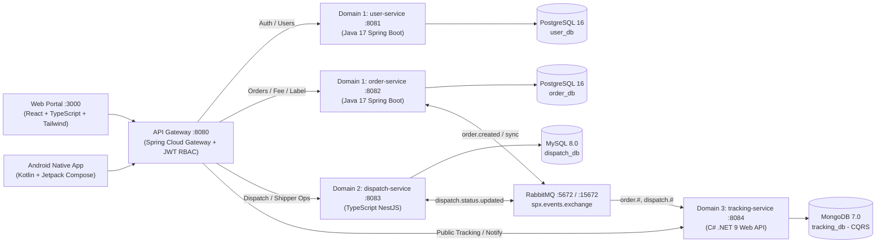
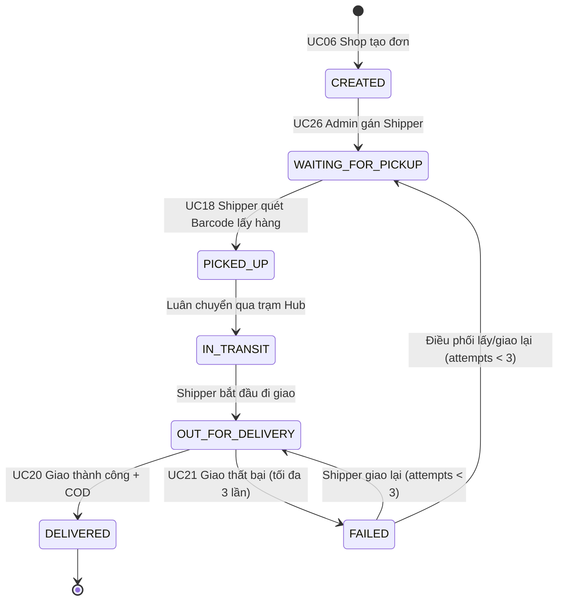
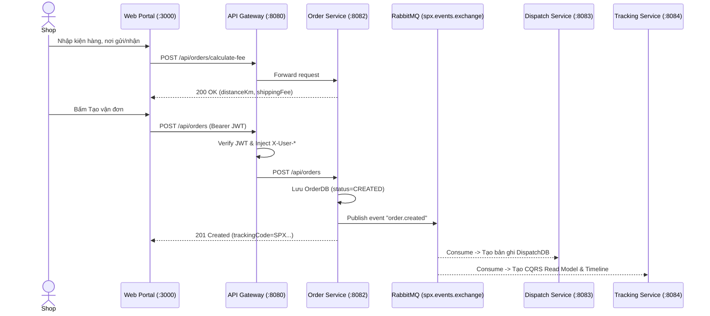
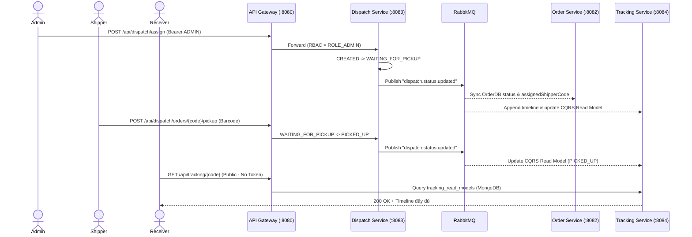

# Kiến Trúc Hướng Dịch Vụ & Thiết Kế Miền (`ARCHITECTURE_SOA.md`)

Tài liệu này trình bày kiến trúc Microservices của đồ án **Hệ thống Quản lý Vận đơn và Điều phối Giao hàng (`SPX-CLONE-2026`)**, đáp ứng đầy đủ các chuẩn đầu ra môn *Phát triển phần mềm hướng dịch vụ (INT1448)*.

---

## 1. Sơ đồ Kiến trúc Tổng thể (3-Domain Polyglot Microservices)

---

## 2. Phân rã Ranh giới Miền (DDD Bounded Contexts)

| Bounded Context | Chủ sở hữu | Dịch vụ & Cổng | Dữ liệu độc lập (Database-per-Service) | Trách nhiệm cốt lõi |
| :--- | :--- | :--- | :--- | :--- |
| **Gateway & RBAC** | Trần Nguyên An | `api-gateway` (`:8080`) | Không dùng DB | Định tuyến tập trung, CORS, xác thực chữ ký JWT, chặn phân quyền 3 vai trò (`ROLE_CUSTOMER`, `ROLE_SHIPPER`, `ROLE_ADMIN`), truyền `X-User-*` đã chuẩn hóa xuống downstream. |
| **Miền 1: Core Auth & Order** | Trần Nguyên An | `user-service` (`:8081`), `order-service` (`:8082`) | PostgreSQL (`user_db`, `order_db`) — ACID | Đăng ký/đăng nhập BCrypt, cấp JWT, tạo vận đơn `SPX...`, tính cước Haversine & khối lượng quy đổi thể tích (`UC08`), sinh dữ liệu tem nhiệt A6 (`UC09`). |
| **Miền 2: Dispatch & Operations** | Đỗ Cao Cường | `dispatch-service` (`:8083`) | MySQL 8.0 (`dispatch_db`) | Quản lý bưu cục Hub, trạng thái Online/Offline của tài xế (`UC16`), Master Dashboard (`UC26`), gán đơn, kiểm tra quét Barcode (`UC18`), giao thành công/thất bại (`UC20`, `UC21`), bảo vệ vòng đời 7 trạng thái. |
| **Miền 3: Tracking & Notification** | Phạm Tuấn Kiệt | `tracking-service` (`:8084`) | MongoDB 7.0 (`tracking_db`) | Lắng nghe sự kiện bất đồng bộ, cập nhật CQRS Read Model (`tracking_read_models`) + Event Store (`tracking_events`), phục vụ tra cứu công khai `UC11` tốc độ cao không cần đăng nhập và lưu thông báo `UC15`. |

---

## 3. Vòng Đời 7 Trạng Thái Vận Đơn (State Machine Diagram)

- Cả **Miền 1 (`WaybillStateMachine.java`)** và **Miền 2 (`waybill-state-machine.ts`)** đều thực thi kiểm tra chuyển trạng thái nghiêm ngặt, từ chối mọi thao tác nhảy cóc (ví dụ `CREATED -> DELIVERED` tại `TC-12`) với mã HTTP `400 Bad Request` (`ERR_INVALID_STATE_TRANSITION`).

---

## 4. Biểu đồ Tuần tự (Sequence Diagrams) — Choreography SAGA & CQRS

### 4.1. Luồng Tạo vận đơn (`UC06`) & Đồng bộ liên miền qua RabbitMQ

### 4.2. Luồng Điều phối (`UC26`) -> Shipper Tác nghiệp (`UC16–UC21`) -> Tra cứu Công khai (`UC11`)

---

## 5. Mô hình Triển khai Sẵn sàng & Dự phòng Môi trường
1. **Docker Mode (`docker-compose.yml`):** Chạy trọn vẹn PostgreSQL x2, MySQL 8, MongoDB 7, RabbitMQ Management, 5 Backend Services và Web Portal Nginx trên mạng `spx-network` với giới hạn RAM tối ưu cho máy cá nhân (`mem_limit` từ 128MB–384MB).
2. **Local Standalone Mode (`scripts/start-local.ps1`):** Khi máy trạm chưa bật Docker Desktop, các dịch vụ tự động chuyển sang cấu hình lưu trữ cục bộ độc lập (H2 PostgreSQL-mode cho Miền 1, SQLite `sql.js` cho Miền 2, File JSON CQRS Store cho Miền 3) và đồng bộ sự kiện bất đồng bộ qua endpoint nội bộ `/internal/events`.
